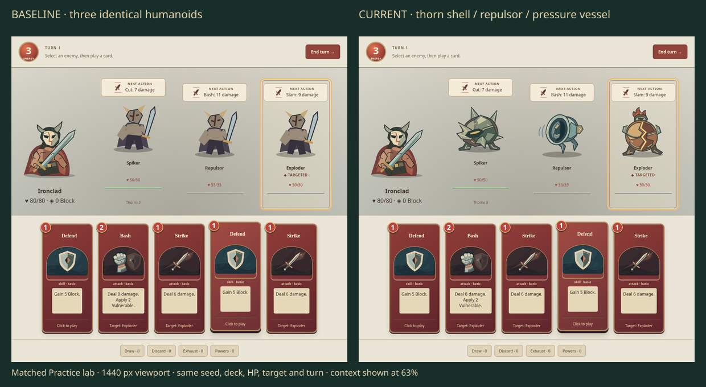
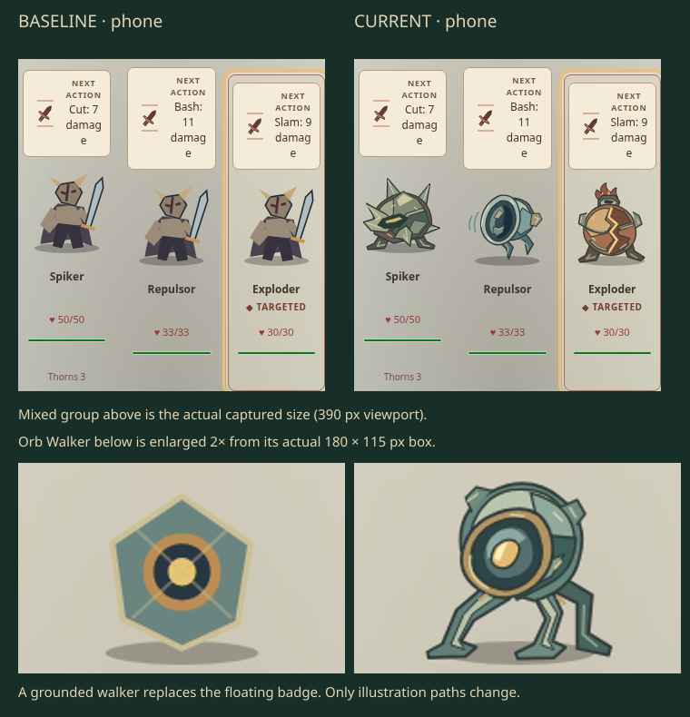

# Beyond constructs

Spiker, Repulsor and Exploder shared the same sword-bearing humanoid. Orb Walker used a floating polygon. Four cast-metal subjects now distinguish the thorn shell, hollow repulsor, pressure vessel and walking lens in combat.





| Subject    | Contour and material                                                   |
| ---------- | ---------------------------------------------------------------------- |
| Spiker     | Low braced shell; unequal forged spines; recessed horizontal slit      |
| Repulsor   | Suspended open bell; dark cavity; swept fins and restrained force arcs |
| Exploder   | Squat copper vessel; open exhaust; hot split seam                      |
| Orb Walker | Pitched lens casing; three bent supports with separated feet           |

Only `BeyondConstructArt.tsx` and four-ID dispatch in `Portrait.tsx` change production behavior. IDs, game rules, content, saves, UI layout, other portraits and the protected work in PRs #62/#74/#75 remain unchanged. This follows main `c9dad09ed48c2d6f1f8176fc1ffb2d66eca4db41`; the precise baseline is also in the [capture receipt](capture-receipt.json).

## Review

Orb Walker was the representative v1. Actual desktop and phone inspection showed a clearer walking silhouette, but the far leg crowded the near foot. The refinement separates that support. After expanding the set, Repulsor's bright central wedge competed with Orb Walker's lens; replacing it with attached inner vanes leaves an open cavity. [Trial and refinement pixels](iterations.webp) retain both decisions. These superseded trials were not promoted separately.

[Spiker and Repulsor](portraits-01.png) · [Exploder and Orb Walker](portraits-02.png): matched 180 × 180 source canvases at enlarged and native size. Combat boxes are 150 × 170 on desktop, approximately 97 × 115 for the phone trio, and 180 × 115 for the single Orb Walker. The square illustration fits within those boxes.

Actual Practice lab screenshots use seed `BEYOND-CONSTRUCTS`, the same deck, enemy order, resources, turn and selected target. Both pairs have identical initial replay bytes, element bounds and intent text. Review images compose actual browser pixels; lossless WebP copies decode identically to the PNG captures. No replacement imagery is generated.

| Matched full combat   | Baseline                               | Current                                |
| --------------------- | -------------------------------------- | -------------------------------------- |
| Mixed group · desktop | [Before](context/trioBefore-1440.webp) | [Current](context/trioAfter-1440.webp) |
| Mixed group · phone   | [Before](context/trioBefore-390.webp)  | [Current](context/trioAfter-390.webp)  |
| Orb Walker · desktop  | [Before](context/orbBefore-1440.webp)  | [Current](context/orbAfter-1440.webp)  |
| Orb Walker · phone    | [Before](context/orbBefore-390.webp)   | [Current](context/orbAfter-390.webp)   |

**Visual verdict: stronger than baseline in author self-review.** Independent visual acceptance remains pending. Existing phone intent word wrapping is visible in both captures and unchanged; this batch does not revise typography or layout. The art is static SVG, with no native model or animation claim.

## Verification and delivery

Source bytes are pinned by the [source receipt](source-receipt.json). Node 24.21.0 / npm 11.19.0; official Google Chrome 156.0.8078.73 in a disposable profile, through the repository's unchanged startup guard. The [capture receipt](capture-receipt.json) includes the vendor URL and package checksum.

- Eight browser journeys pass: the two new construct scenarios, the existing City portrait journey and all five existing Spire journeys. They cover accessible names/intents/HP, keyboard targeting, target selection without save changes, Strike accounting, practice reload and normal-save isolation, map/reward/shop/rest/collection flows and phone layout.
- 48 existing Spire game/expansion tests pass.
- Scoped ESLint, workspace TypeScript and production build pass. The build retains its existing large-chunk warning.
- All 39 enemy SVGs decode: exactly the four scoped IDs change; 35 remain pixel-identical. [Portrait comparison](portrait-review.json).
- All 644 catalogue SVGs decode and remain pixel-identical. Combat portraits are outside that catalogue. [Cabinet comparison](cabinet-review.json).
- Repository formatting, inventory and links pass: 819 managed sources, no inventory errors.

Retained logs: [browser](logs/browser.log), [rules](logs/rules.log), [types](logs/types.log), [build](logs/build.log), [maintenance](logs/maintenance.log). Scoped ESLint exited successfully with no diagnostics.

The first baseline test mistakenly expected Repulsor to begin with Repulse. The actual seeded action is Bash; the expectation was corrected before implementation and the affected baseline journey passed. No game behavior, assertion strength or timeout was altered to achieve a pass.

Scoped commands:

```sh
npx eslint src/games/spire/ui/BeyondConstructArt.tsx src/games/spire/ui/Portrait.tsx tests/browser/spire-constructs.spec.ts --max-warnings=0
npm run typecheck
npm run test -- src/games/spire/domain/game.test.ts src/games/spire/domain/expansion.test.ts
npm run test:browser -- --project=functional tests/browser/spire.spec.ts tests/browser/spire-city-art.spec.ts tests/browser/spire-constructs.spec.ts
npm run build
npm run assets:export -- test-results/FRESH
npm run format:maintenance
```

The full cross-game application/simulation suite, geometry, native Blender and exhaustive browser suites were not run for this isolated SVG change. No Site deployment or merge occurred. Issue creation was denied by automatic approval review; external publication and final-head hosted CI remain blocked, so no issue/PR link or hosted pass is claimed. The local commit and draft publication text are the handoff, pending the parent resolving that authorization block.
