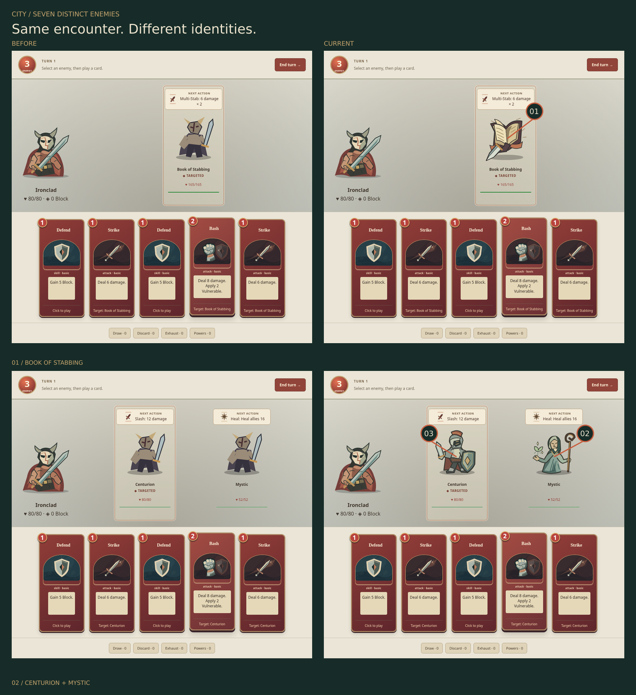
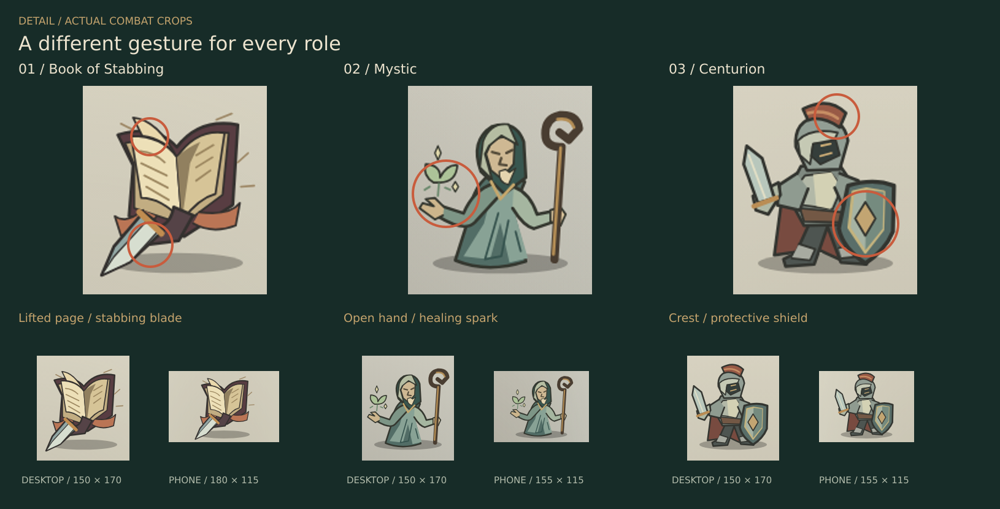

# City portraits · issue 68

**Seven enemies. Seven gestures.**





| Subject          | Identifying gesture              |
| ---------------- | -------------------------------- |
| Book of Stabbing | Sprung pages; diagonal blade     |
| Mystic           | Open healing hand; curved staff  |
| Centurion        | Planted armor; protective shield |
| Chosen           | Hooked mask; descending hex      |
| Spheric Guardian | Nested shell; recessed lens      |
| Snake Plant      | Rooted S-curve; hinged jaw       |
| Taskmaster       | Braced torso; overhead whip      |

Scope: [issue #68](https://github.com/qianyizhang/game/issues/68), the seven subjects above. Slavers, Champ, Act I, Act III, character art and the PR62 action-art files retain their existing art. The only production edit is the City dispatch and drawing in `src/games/spire/ui/Portrait.tsx`.

## Pixels

Baseline: main `14f31860a4bf5c7bf568fbacf804c8cd60a3a9ca`, including PR65. Current source: [SHA-256 receipt](source-receipt.json). Chrome 156.0.8078.73, reduced motion, device scale 1, seed `CITY-ART-68`; identical starting deck, resources and enemy order.

Representative v1: Book and Mystic. Author inspection at actual phone size found a flat page block and a weak face/healing accent. The refinement lifts one page and strengthens the face and healing spark before expanding the other five subjects.

[V1 → refinement](representatives.png)

| All seven · baseline / current | Native 180 × 180 export + enlarged |
| ------------------------------ | ---------------------------------- |
| Book / Mystic                  | [Sheet 1](portraits-01.png)        |
| Centurion / Chosen             | [Sheet 2](portraits-02.png)        |
| Guardian / Snake Plant         | [Sheet 3](portraits-03.png)        |
| Taskmaster                     | [Sheet 4](portraits-04.png)        |

The export sheets show the 180 × 180 source canvas. Actual combat SVG boxes are 150 × 170 on desktop; on a 390 px phone, 155 × 115 for the allied pair and 180 × 115 for the single-enemy encounters. The square drawing fits inside each box. The close-up poster retains native browser crops below its 2× enlargements.

| Matched actual combat | Desktop · 1440 px                                  | Phone · 390 px                                    |
| --------------------- | -------------------------------------------------- | ------------------------------------------------- |
| Book                  | [Before / current](context/book-combat.webp)       | [Before / current](context/book-phone.webp)       |
| Centurion + Mystic    | [Before / current](context/allies-combat.webp)     | [Before / current](context/allies-phone.webp)     |
| Chosen                | [Before / current](context/chosen-combat.webp)     | [Before / current](context/chosen-phone.webp)     |
| Guardian              | [Before / current](context/guardian-combat.webp)   | [Before / current](context/guardian-phone.webp)   |
| Snake Plant           | [Before / current](context/plant-combat.webp)      | [Before / current](context/plant-phone.webp)      |
| Taskmaster            | [Before / current](context/taskmaster-combat.webp) | [Before / current](context/taskmaster-phone.webp) |

Screenshots come from the actual Practice lab combat surface. Overview composition is scaled; context files and the lower close-up crops preserve capture size. Labels and circles annotate existing pixels. No generated replacement imagery is used. [Combat receipt](combat-receipt.json) records dimensions, names, HP, intents and target labels.

Author visual review: distinct contours and gestures at native and enlarged sizes; no collision with intent, HP or selection UI. This is self-review. Independent pixel review remains pending; the PR stays draft.

## Verification

| Scope                           | Result                                                                                                                                                                              |
| ------------------------------- | ----------------------------------------------------------------------------------------------------------------------------------------------------------------------------------- |
| Portrait SVGs                   | 42 before + 42 current decode; exactly seven changed, 35 unchanged; no added/removed IDs. [Pixel receipt](export-review.json)                                                       |
| Existing export cabinet         | 644 before + 644 current decode; all 644 unchanged. [Cabinet receipt](cabinet-review.json)                                                                                          |
| Spire rules                     | 48 existing game/expansion tests pass                                                                                                                                               |
| Existing Spire browser journeys | Five pass: intents, combat/reward/save, shop/rest/victory, choices/legacy isolation, phone layout                                                                                   |
| City browser journey            | Seven subjects: accessible intents/health, keyboard target, unchanged save bytes on selection, standalone SVG decoding, desktop/phone layout, Strike accounting and practice reload |

The new test initially omitted the existing “Next action” accessible-description prefix. Correcting that expectation produced a passing focused rerun; application behavior did not change. Existing successful journeys were reused.

Commands, using the pinned Node 24.21.0/npm 11.19.0 runtime:

```sh
npx eslint src/games/spire/ui/Portrait.tsx tests/browser/spire-city-art.spec.ts --max-warnings=0
npx tsc --noEmit
npm run test -- src/games/spire/domain/game.test.ts src/games/spire/domain/expansion.test.ts
npx playwright test tests/browser/spire.spec.ts tests/browser/spire-city-art.spec.ts --project=functional
npm run assets:export -- test-results/city-cabinet-current
```

The saved cloud environment uses the repo's supported `CARD_WORKSHOP_CHROME_EXECUTABLE` option with an extracted official Google Chrome binary. The normal startup guard remains in effect; profiles are disposable. No user Mac, native modeling, gameplay/content/save changes or full cross-game campaign is involved. Scoped lint/types, formatting/inventory and production build complete the local checks; required hosted checks are tracked on the exact PR head.
