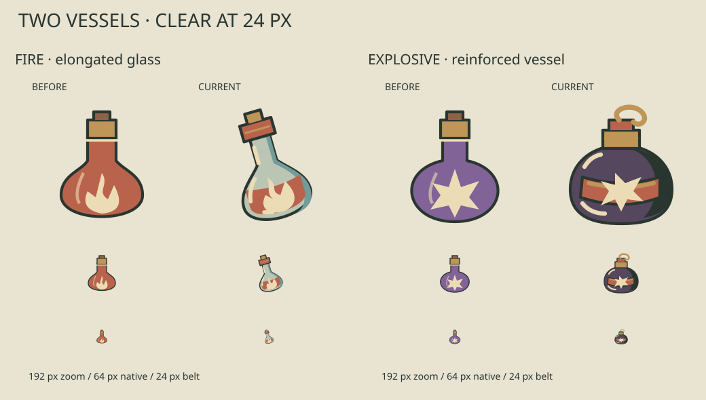
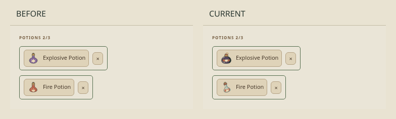

# Spire damage potions · local checkpoint

**Two vessels. Clear at 24 px.**

## Candidate / problem

Fire and Explosive Potion used nearly the same upright opaque bulb. At the
24 px combat belt, color and tiny interior marks carried most of the difference.
The bounded hypothesis: an elongated glass flask versus a squat reinforced vessel
will separate the two damage roles before reading their names.

Latest main inspected: `08ca09dcac428f963c581d8bd05485a097323ad7`.
Open issue/draft ledger inspected before selection: dependency PRs #66/#67 and
standalone studies #53–55/#64; recent game-art issues were complete. This does not
resume a held native trial or overlap the preserved Beyond constructs batch.

## Actual belt · 24 px

[Desktop belt](belt-desktop.png) · [Desktop combat context](combat-desktop.png) ·
[Phone combat context](combat-phone.png)

## Collection / close-ups

[Desktop collection](collection-desktop.png) · [Phone collection](collection-phone.png) ·
[Native and enlarged pair](native-enlarged.png) · [Representative v1](v1.png)

## V1 → V2

- **Fire:** tilted glass, visible fill level and curved reflections. V1's gold
  flame blended into the glass; v2 raises the coral liquid and uses an ivory flame.
- **Explosive:** broad dark body, reinforced copper band and fitted stopper loop.
  V1's regular star read as a badge; v2 uses an uneven burst and fewer edge cuts.

The whole collection, desktop/phone combat context, 24 px belt and enlarged
subjects were inspected directly by the author. Parent/independent pixel review
has **not** been claimed.

## Scope / verification

- 🟢 **2 changed / 648 unchanged** exported illustrations; all 650 SVGs decode.
- 🟢 Three scoped browser journeys, including keyboard-targeted Fire use,
  area damage, no Energy use, reload, export, collection labels and phone layout.
- 🟢 30 domain tests; targeted ESLint, application/test types, production build,
  formatting and inventory.
- 🟡 Local checkpoint only; no push, issue, PR, merge, Library or Site publication.

[Check record and limits](checks.md) · [Pixel scope report](svg-review.json) ·
[Source/image hashes and capture conditions](provenance.json)

Only `WorldItemArt.tsx` presentation and its relevant browser regression change.
IDs, potion rules, targeting, costs, persistence, unknown-ID fallback and accessible
HTML controls remain intact. The combat witness is a legal prefix of the existing
winning replay. Its enemy portraits are unchanged latest-main assets; no preserved
Beyond candidate files were accessed or transported.
