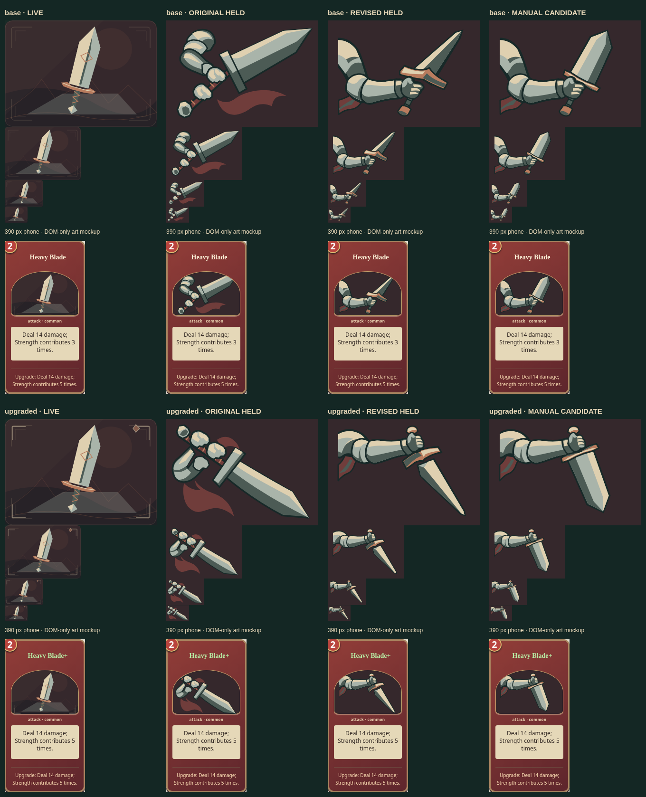

# Heavy Blade: manual broad-blade candidates

These two hand-authored derivatives repair the held connected-arm pair. They are
source candidates for user review, with no game selection or runtime adaptation.
No API call or image edit was made. The new $20 repair allowance remains untouched;
the coordinator's historical $28 unknown reservations remain unresolved.

Columns: live editable source, original held pair, revised held pair, manual
candidate. Each shows 320×224, 160×112, 80×56 and 48×34. The card crops use the real
390×844 phone collection layout: 169×322 card, 141×98.6875 illustration. Candidate
and upgraded illustration views are temporary DOM-only mockups; no saved game,
selection or component was modified. The upgraded mockup also updates the visible
name/effect, rather than claiming the collection normally displays upgraded cards.

## Reuse decision and exact parents

The stable slots are `spire/heavyBlade` and `spire/heavyBlade-upgraded`, both
160×112. The comparison captures live source at `cfa7bd69722c3983781eaa2f87752d06697ccab2`, using the broad
`Blade heavy` primitive. Its base and upgrade share a weapon pose. The original
[held pair](../refinement-candidates-2026-11-06/spire-swords/) establishes mass but
has unsupported/crowded wrists. The later
[connected-arm pair](../refinement-candidates-2026-11-06/spire-heavyblade-revision/)
repairs arm support but tapers into a light-looking sword. All four remain held.

Adaptation is preferable to another generation: the revised arm, wrist, fingers,
handle and cloth are usable. Only seven path `d` attributes per scene change:
four steel planes and three guard planes. The blade retains substantial width
before a short terminal taper; the guard fits its root and the blade follows the
handle axis. Base retains the raised ready pose; upgrade retains the downward
chop. Palette, canvas, path order and every other path attribute are inherited.
No replacement of the live source is proposed here.

The [additive handoff](registration-handoff.json) records the exact parent revision
IDs and new output digests. Its parents already exist in the canonical library;
no old request, prompt or image is copied. Existing originals, requests, reviews,
registrations and selections match the rebased main across 107 protected files.
The existing Spire art/history workflow owns any later integration. This bounded
repair needs no separate issue or new maintenance tooling.

## Review and validation

- Anatomy: continuous inherited single arm and fitted grip remain legible. This
  preserves the earlier anatomical repair; it does not claim new hand anatomy.
- Blade mass: improved in both candidates at native/compact sizes and the phone
  mockup. Three broad steel values distinguish face, bevel and thickness.
- Action: ready versus descending is clear without hue changes. The single-hand
  fantasy weight remains stylized; compact fingers are simplified, not anatomical
  proof. User aesthetic acceptance is pending.
- Technical: both pass the owning static SVG validator at 800×560. All geometry
  remains in the viewBox, including a conservative 4-unit stroke allowance:
  base `[51,43.9]–[654.8,506.5]`, upgrade `[51,33.9]–[642.3,500.1]`.
  Exactly 25/26 other paths are unchanged. No raster, script or external resource.
- The sole retained comparison is 1360×1678 sRGB PNG. Lossless optimization saved
  15,368 bytes; decoded RGBA, dimensions, alpha and color interpretation match.
  Masters, individual phone crops and diagnostics remain ignored temporary output.
- Rendered in headless Chromium; the phone run reported no page errors or text
  overflow. No claim of gameplay integration or complete browser-suite coverage.

Canonical registration is deliberately staged for the serial coordinator. The
production library is untouched; neither candidate has a selectable runtime file.
Local checks passed with Node 24.21.0 / npm 11.19.0: formatting/inventory/links,
16 owning history tests, production history verification (709 assets, 168
revisions, 709 registered sources, zero selections) and production build. The
build retains its existing chunk-size warning. No runtime code changed, so no
application simulations or native geometry suites were claimed.

An isolated copy imported the handoff successfully (709 assets, 171 revisions,
zero selections). The real gallery served that isolated history: both slot and
compact previews decoded, exact parent links opened the held revisions, the
manual notes and comparison loaded, and **Use in game** stayed disabled. There
were no page errors. The canonical library, selected-art file and existing
source evidence were rechecked unchanged afterward.

Delivery reconciled onto main `c66138f2fa320ac919266b310cab5da0d2db76ef` after
#138 merged. Heavy Blade renderers, held parents and selections did not change,
so the matched visual evidence remains valid. History/import/gallery and
inventory checks passed again against that updated base.
