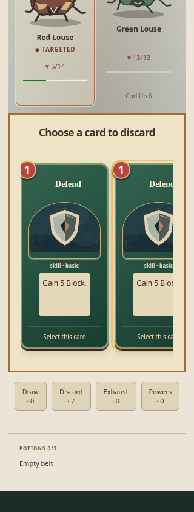
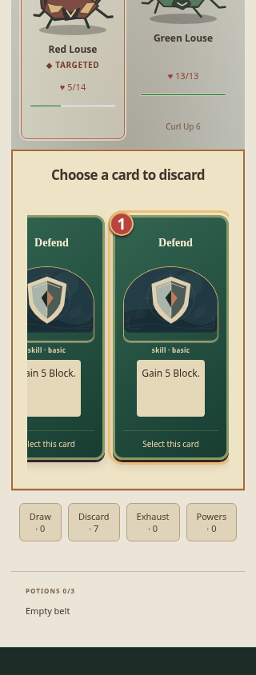
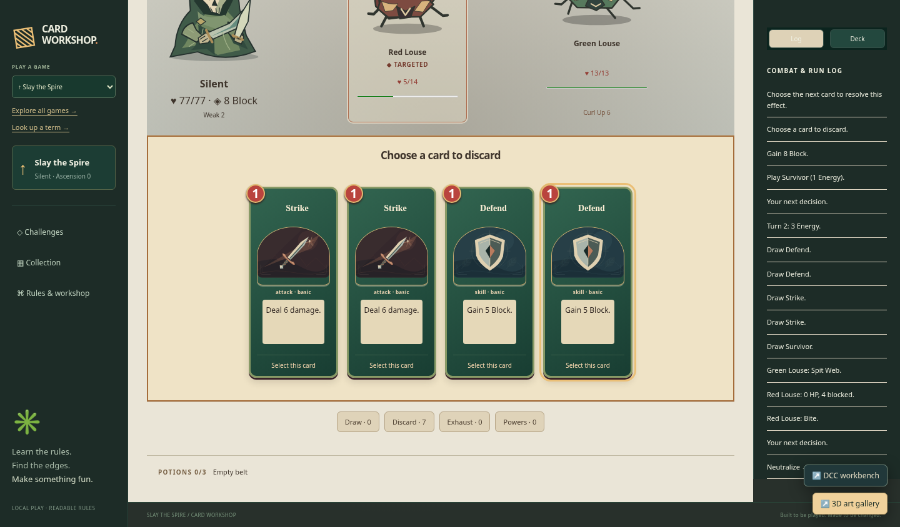

# Keep focused Spire combat cards visible on narrow screens

| Original                                                     | Updated                                                           |
| ------------------------------------------------------------ | ----------------------------------------------------------------- |
|  |  |

Matched 320 × 844, scale 1, Silent, IRONCLAD-01, +7 max HP, first fight, turn-two Survivor discard choice. Original focused card spans x189–334 in region x34–286; Updated spans x141–286. Both settle across five 150 ms samples. Matched 1440 px captures are byte-identical; one copy is retained.

- Original source: `bebe081234cfbacab30389373f274e7e88be9759`.
- Reviewed implementation: `de46df9eec04df2fd435acbd7ff1b79d2c24c06c`.
- Change: Reveal keyboard-focused cards using nearest scrolling and suspend mobile hand snapping only while a card has visible keyboard focus.
- Acceptance: Fully reveal cards through forward/reverse Tab in normal and choice hands; Enter acts on the exact focused card; retain touch and disabled/read-only scrolling, energy and replay accounting; avoid document overflow.

The original regression failed at the unchanged 5000 ms visibility assertion. A CSS-only V1 failed at 320/390 px; the final focus handler plus CSS passed 3/3 in 11.2 s. Separate challenge and passive-board checks passed; the challenge probe was corrected to respect one disabled Dazed card. Pointer/touch snapping, disabled inspection and accepted commands remain intact.

Pass: three tracked browser cases at 320/390/1440 px, plus challenge and passive-board consumer checks; scoped lint/format/inventory and build. Independent review accepted. The retained 390 px captures differ in scroll/hover framing, so no unchanged-pixel claim is made there. Full local application/simulation, unrelated browser and native/geometry suites were not run.

Local runtime: Node 24.21.0, npm 11.19.0, Playwright 1.64.0, Chrome 156.0.8078.79. Existing startup, assertion and test guards were retained. This publication reuses valid captures and checks; it adds no gameplay changes. Hosted CI is reported on the draft PR.

Image SHA-256:

- `original-320.png`: `e813d62cec128e3fc0b994c334f316b6a0a3d4dcf6424e4e48f1421c7eff3fc8`
- `updated-320.png`: `d930c2752b45ddd439a3ca644a9cf8ab8f597356785dd562bbed7e4d1446d2d8`
- `unchanged-1440.png`: `2c9d22e3f383990906a953ad67f7f52ff41f2f62a827a2bf3c26b1b62cf0e3de`
