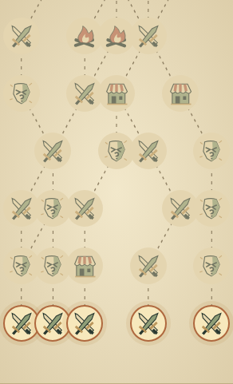
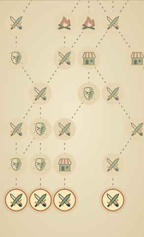

# Spire route choices on narrow phones

| Original                                                                     | Updated                                                                   |
| ---------------------------------------------------------------------------- | ------------------------------------------------------------------------- |
|  |  |

[Original context](original-context-320.png) · [Updated context and scrolling hint](updated-context-320.png) · [Rightmost route after panning](updated-right-map-320.png)

At 320 × 844, adjacent 46 px buttons had centers 39.766 px apart. A touch two
pixels inside the first room's right edge selected its neighbor, `act1-0-1`,
instead of `act1-0-0`. The fix keeps 46 px controls and a minimum 360 px map
canvas, with scrolling confined to the map and a hint when needed. Starting
controls now have at least 3.016 px between them; all routes remain reachable.

## Matched evidence

Original source: `bebe081234cfbacab30389373f274e7e88be9759`. Updated source:
`b4c329a9cb34b79d3371d280dca526acb606aba7`. These are preserved actual browser
captures, not regenerated for publication.

Chrome 156.0.8078.79, device scale 1, viewport 320 × 844, default IRONCLAD-01
after “Obtain +8 Max HP”. Both map crops are 292 × 481 at native zoom,
scrollTop 740 and scrollLeft 0. The rightmost-route view is explicitly panned
68 px. Context views share the panel-top anchor; the updated hint adds one line.

The [390 × 844 view](original-390.png) and [1440 × 1080 view](original-1440.png)
are unchanged: each original/updated pair is byte-identical, so one copy of each
is retained here. Rules, seeded routes, artwork and save formats are unchanged.

## Verification and independent review

- `playwright test --project=functional tests/browser/spire.spec.ts tests/browser/spire-policy.spec.ts`: 7/7 passed (40.2 s), covering touch panning, edge taps, keyboard access, route alignment, saves and passive replay isolation. The overlap regression fails on the original source.
- Final regression after typed test-bound refinement: 1/1 passed (6.5 s); six unchanged journeys retain the preceding results. Scoped ESLint, root TypeScript, build and formatting/inventory/link checks passed. Build retained its existing large-chunk warning.
- Independent reviewer accepted the final three-file diff and actual pixels; live inspection confirmed control size/spacing, contained scrolling, ArrowRight/Tab access and Enter selecting the rightmost route. Context and panned-right evidence resolved the initial capture completeness concern.
- Full application/simulation, geometry, native Blender and unrelated browser suites were not run. Hosted checks belong to the linked PR; local browser evidence used the pinned Node 24.21.0/npm 11.19.0 runtime with CI unset and existing guards intact.

The ignored `.artifacts/spire-map-inspection/` bundle retains the original failure
trace, logs, layout measurements and capture scripts. This directory contains the
small durable comparison set for review; the PR records publication and CI status.
