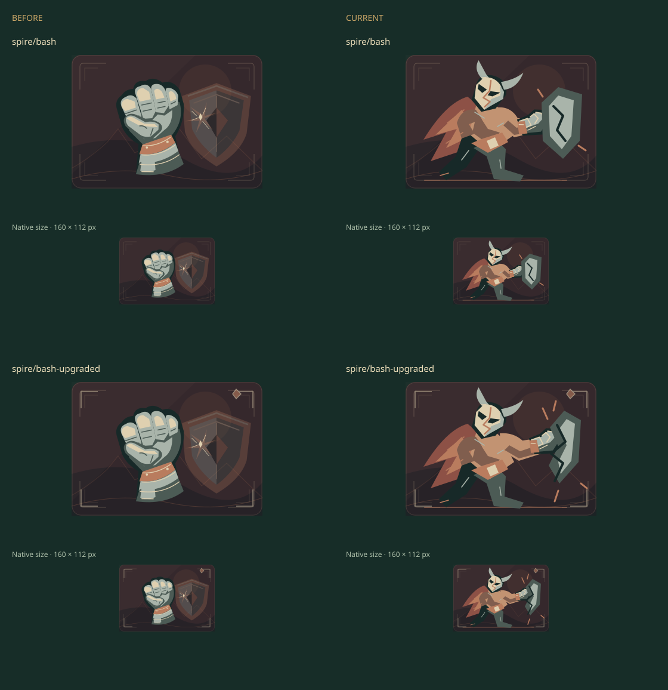
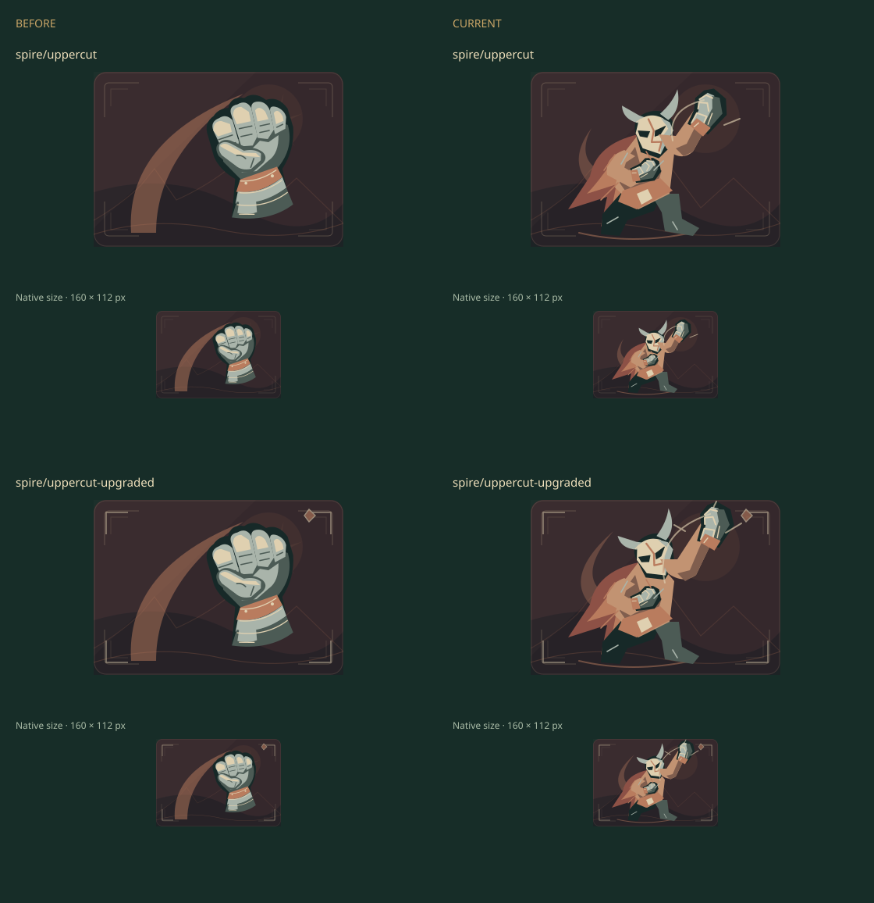

# Ironclad physical actions · issue 57

Representative WIP for [issue 57](https://github.com/qianyizhang/game/issues/57).
Bash and Uppercut now use connected, planted figures with opposing forward/rising
motions. Each upgrade changes the action or its material result. Anger, Flex,
Pummel and Rage remain outside this first representative revision.

Baseline: main `da8b3c39097a27a300b414af9b89bdceb234a1ff`; its illustration
sources equal the retained `a88bebd` export. Both cabinets decode 644 SVGs. Exactly
`spire/bash`, `spire/bash-upgraded`, `spire/uppercut` and
`spire/uppercut-upgraded` differ; 640 exports are unchanged. The comparison uses
Sharp 0.35.5 at matched native 160 × 112 and 2× sizes. These are exported-art
sheets, not browser screenshots or aesthetic approval.

Author review: the forward/rising gestures read at native size. Uppercut+'s
knuckles clip the top edge and need clearance before extending this direction.
The full six-set, actual hand/deck/upgrade contexts and independent visual
acceptance remain pending. No rules, UI controls, content definitions or saves
changed. No 3D construction or native source changed.

The baseline Spire collection/phone journey passed through the existing official
Chrome harness. Current artwork local E2E and final scoped checks remain pending;
that baseline pass is not credited to the changed artwork. Chrome provenance:
Google Chrome 156.0.8078.73, vendor package from
`https://dl.google.com/linux/direct/google-chrome-stable_current_amd64.deb`, SHA-256
`fd19c6895dad77f4d7f712c2d9f0d5eb682f4a6e7ff22b1bd0d40d03710d288c`.
