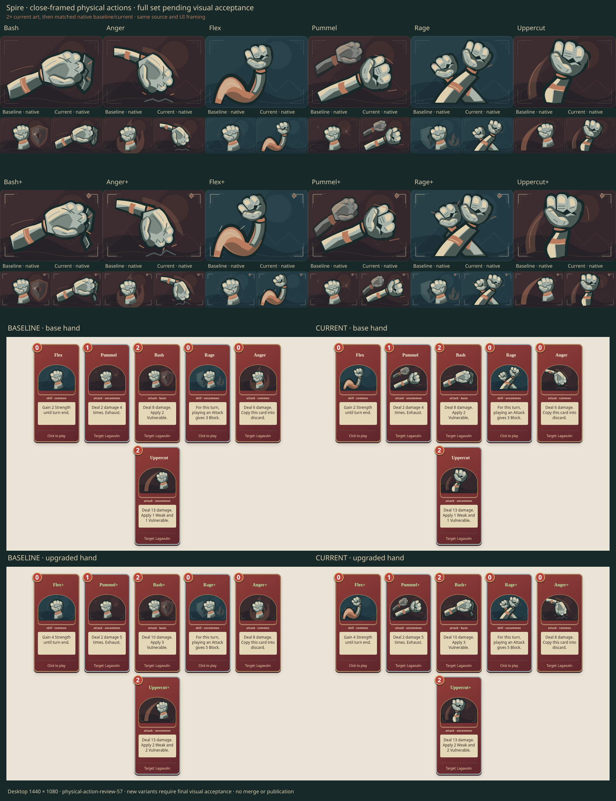

# Ironclad physical actions · close-framed set awaiting final review

The user approved the two-card direction at `2af07ce1319c6dbb40a5d5df5daacc280b7febf3`
with “yes, new ones better.” That approves the close-framed Bash/Uppercut direction;
**the full twelve-variant set still needs final visual acceptance.** PR #62 remains
draft for final visual review; no merge is claimed.

## Result and variants

| Card     | Leading action                                         | Upgrade development                                    |
| -------- | ------------------------------------------------------ | ------------------------------------------------------ |
| Bash     | Large horizontal strike against a recessed guard       | Longer reach splits and displaces the guard            |
| Anger    | Descending hammer blow                                 | Steeper wrist and forearm drive, deeper impact         |
| Flex     | Continuous curling upper arm, elbow and fitted forearm | Stronger contraction and changed wrist angle           |
| Pummel   | Foreshortened punch with a quieter return hand         | Near punch extends as the return hand changes position |
| Rage     | Unequal fists over crossed forearms                    | Tighter, raised guard                                  |
| Uppercut | Bent forearm carrying a rising fist                    | More vertical reach and longer rising arc              |

Rounded metal planes, fitted copper straps and one leading action replace the
repeated detached-fist motif. The approved Bash and Uppercut base images remain
pixel-identical to the two-card sample at native size. Their shared hand sources
now live with the other four actions in `art/physical-actions.tsx`; each scene owns
its forearm geometry, composition and variant. `AbilityArt.tsx` selects the six
upgrade scenes. Other card art and palette selection stay unchanged.

Set review caught Flex's upper arm reading as a narrow S-shaped tube. Widening
the biceps and elbow and separating their large light/shadow planes gave the
curl a broader supporting mass. The revised set was inspected at native and 2×
size, inside the actual arched card aperture, and in small deck previews.
Author inspection supports sending this set for review; it does not establish
final user acceptance.

## Rejected drafts and lesson

The user rejected full-figure v1 `89d9b5380d74c0f158c8f13aeac85031b26f8d1c`
and the six-card revision `7c409ca0e6350fe487117c982eebbe00a14db39b` as worse in
context and aesthetics. Both remain preserved on local
`rejected/spire-physical-v1-57` and `rejected/spire-physical-final-57` branches.
Neither is accepted or eligible for merge.

Those figures shrank the striking hand, while large masks and jagged cloaks
competed with the action. Flat angular anatomy lost the baseline's rounded
volume. Distinctness alone was not improvement. The useful constraints are a
large focal hand, quiet supporting forms, connected structure and restrained metal
planes. Judge the actual hand view before expanding a representative direction.

## Evidence and scoped checks

Artwork source is byte-identical to local revision
`db382b4dcc728ff2adc196032b5c56a5521eec0c`. The delivery integrates main
`14f31860a4bf5c7bf568fbacf804c8cd60a3a9ca`, preserving its baked-gallery and
performance work. The existing source checks and images below are reused; these
are not fresh runs of the integrated checkout. Hosted checks are reported on the PR.

Private Library review image: `libfile_cf237cace1548191b6ed98e3567d99a5`.
It shows all twelve current illustrations at 2×, matched baseline/current native
160 × 112 views, and base/upgraded hands at matching desktop scale. PNG SHA-256:
`ab816309893b574e45e99444c5297430bd54049dfb15e60187af098dc841278d`.
[Evidence manifest](close-set-evidence.json) pins the source bytes and comparison.

- All 644 baseline and current SVGs decode through Sharp 0.35.5. Exactly twelve
  expected exports change; 632 remain byte-identical, including all Silent and
  nonselected Ironclad art. Baseline: `da8b3c39097a27a300b414af9b89bdceb234a1ff`.
- Scoped ESLint, TypeScript, formatting, production build and inventory checks
  pass. The build retains its large-chunk advisory; no bundle-size improvement is claimed.
- Two focused Chrome journeys pass (9.7 s): existing Spire collection/phone and
  temporary full-set base/upgraded hand capture. They check six labels and costs,
  decorative SVG attributes, tiny deck delivery, normal-save preservation,
  JavaScript errors and no page overflow at 390 px.
- Existing baseline captures and unchanged earlier rules/reward/Smith/reload
  evidence were reused. The relevant prior behavior checks are recorded with the
  rejected revision; no fresh rules coverage is claimed from these visual checks.
  No full suite or native/geometry work was run for this static SVG change.

Capture setup: `physical-action-review-57`, deck
`bash,anger,flex,pummel,rage,uppercut`, Bag of Preparation and Lagavulin; repeat with
all six upgraded. Desktop 1440 × 1080, phone 390 × 844. The unchanged harness uses
Google Chrome 156.0.8078.73 from the official vendor package, SHA-256
`fd19c6895dad77f4d7f712c2d9f0d5eb682f4a6e7ff22b1bd0d40d03710d288c`.

Raw outputs, the temporary capture journey and composition helper are retained in
ignored `.artifacts/spire-close-set-57/` and `test-results/issue57-close-set-*` for
this open review. Revisit retention after acceptance or 2026-11-27.

Final visual acceptance and merge remain separate from source validation.
The PR remains draft; the rejected full-figure revisions are retained in history.
