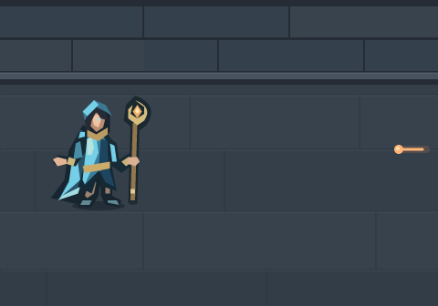

# An Empty Target · manually composed reference

**No-spend preparation, not API output or accepted story canon.** This scene uses
Mira's unchanged accepted geometry. The earlier SVG attempt remains unknown and
has no image revision. No paid request was made in this continuation.

[Native SVG](reference-manual.svg) · [Exact proposed PNG input](reference-manual.png) ·
[First GIF draft, never dispatched](first-gif-draft.json)

## Reuse and provenance

The existing figure is sufficient for this narrow spatial reference. No new
character drawing or pose is needed. The worker invoked unchanged
[`drawHero`](https://github.com/qianyizhang/game/blob/3a59621069dd1fe912a749d851d27e993507f5dd/packages/diablo2/src/ui/hero-art.ts)
with `sorceress`, `#75cfe7`, time `0`, recording its fill operations into SVG.
All **35 paths, their exact path strings, fill colors and order** are preserved;
the whole figure receives only `translate(108 190) scale(2.5)`. Resvg 2.6.2
rendered the unchanged SVG into the opaque 480 × 336 PNG. The source's last
change is `adad00ceab14c218b93fe3f894b2a5172746f770`; its current SHA-256 is
`d253bf8ae66e721fea8049ae6aab00cdc0c4f9861874757ed130b773bdadc116`.
The recorded ordered fill-sequence SHA-256 is
`e681ef8cca4dafb68c723d9444925038dbc92c7cc6bf76feb7998ca829fb627b`.
No accepted source was edited. This is a composition derivative, not a newly
designed Mira or a pixel-identical capture of Canvas antialiasing.

The quiet slate floor/wall uses the existing
[crypt palette](https://github.com/qianyizhang/game/blob/3a59621069dd1fe912a749d851d27e993507f5dd/packages/diablo2/src/ui/crypt-environment.ts).
The single warm circular head and short rightward trail follow the existing
[projectile presentation](https://github.com/qianyizhang/game/blob/3a59621069dd1fe912a749d851d27e993507f5dd/packages/diablo2/src/ui/render.ts#L695),
with a restrained fire-colored glow. Wall, floor, contact shadows and projectile
are explicitly composed scene geometry; this is not a gameplay screenshot or
a claim that the map contains this exact arrangement. One 4.4 KB SVG and its
14.4 KB PNG suffice; no frame catalogue, alternate character or geometry JSON.

## Actual visual assessment

The worker inspected the 480 × 336 PNG and a temporary 320 × 224 phone render.
One complete Mira is visible: blue hood, swept cyan cape, fitted split coat,
brass belt, bronze crescent staff and both boots. The full staff has margin
above and below; its tip and the boots meet their contact shadows. The warm
projectile head is left of its trail and remains visible at phone size. The
background is quiet enough to keep those two subjects distinct.

The future landing is bare floor at anchor `(355,190)`, with a standing baseline
near `y=227`. The translated complete future figure would occupy approximately
`x=302..415`. Initially the shot head at `(437,164)` is to its right. The first
clip should finish with its head at `x=250` and trail ending near `x=276`,
visibly clear of the entire future figure footprint. No destination marker or
second Mira is drawn. This staging gives the proposed ordering something
specific to verify; a still does not prove a successful escape or legal game
state. The source-grounded learned-skill/clear-landing assumptions remain in
the [original brief](../story-emberwake-empty-target-2026-11-06/README.md).

**Useful with limits:** Mira's accepted frontal pose does not look directly
toward the shot, and the spell reads as the game's small warm head/trail rather
than an elaborate flame. Keep those identities rather than redesigning them.
The first animation should establish the approach and clear the landing; the
later blink needs its own continuity, planted-feet and projectile-order review.
No animated behavior or visual acceptance is claimed yet.

## Exact next step and planning bound

[The draft](first-gif-draft.json) contains the exact proposed prompt/settings,
PNG digest and multipart field name once. **Too Close:** Mira stays planted;
one projectile moves left from `x=437` to `250`, clearing the future landing.
Only a tiny optional cold cue begins beside her existing free hand at the end.
There is no teleport, impact or second character in this first clip.

The [current guide](https://developers.openai.com/api/docs/guides/image-generation)
and [edits schema](https://developers.openai.com/api/reference/resources/images/methods/edit)
were checked November 6: reference-guided native GIF uses `/v1/images/edits`,
2–16 frames, and dimensions divisible by 16. Proposed settings are Sunburst,
high quality/complexity, `n=1`, 480 × 336, 12 frames × 160 ms (1.92 seconds),
one PNG input, zero retries, no streaming, partial images or compression field.
The exact PNG has **not** been sent to an image-generation service.

**US$0.25 per-call conservative planning bound**, not an enforced charge cap:
4,000 output image tokens × US$30/M = US$0.12; 10,000 input image tokens ×
US$8/M = US$0.08; 10,000 text tokens × US$5/M = US$0.05, at the
[current rates](https://developers.openai.com/api/docs/models/gpt-image-2.6-sunburst).
The earlier real [Spire receipt](https://github.com/qianyizhang/game/blob/art/story-spire-quiet-breath-2026-11-06/docs/art/assets/expansion-story-clips-2026-11-06/spire-one-quiet-breath/calls/chapter-1.json)
returned 16 high-quality 480 × 336 frames for US$0.063195 estimated from 1,869
output image, 630 input image and 417 text tokens. This verifies an empirical
comparison, not a guaranteed upper limit for a different scene. The draft's
allowances are deliberately larger; the API has no dollar-cap field. A separate
finite grant is required before any dispatch. Keep a future native result as
GIF; decode frames only temporarily for motion review.

## Frozen attempt and coordinator handoff

The original three files remain byte-for-byte unchanged at `19fa983`:
README `3a0fe7ee306ec7bdb8d7ba4951be94d226ef8c5517774ecc3e5734ca35e48f15`;
request `41cba59fed495e3a179b2a59af0cf21fca74ef4414f3d1df9e0541b5e097943f`;
outcome `8ae625aa42530c2921a7e2a69b5c1aa4e90b54464966c63eb7fccdc5c9249a93`.
That HTTP 502 attempt is never retried or assigned an image revision.

The coordinator's updated ledger supersedes the original brief's dated pool
snapshot: US$6.760155 successful estimates + US$28 unresolved reservations,
including the held US$3 = **US$34.760155 inclusive**, US$5.239845 uncommitted.
There is no active paid grant. This preparation adds US$0.

Keep this manual reference as a separate source candidate on the same isolated
branch. Shared registry, selections, game/default files and other candidates
stay unchanged; no filler PR is opened. If later registered by the coordinator,
use a new `manual` attempt with the SVG as composed source and PNG as its render
derivative. Do not parent either to the missing API result. The GIF draft is
preparation, not an attempt. Next action: review this reference and issue a
separate finite grant only if the first animation is wanted.
