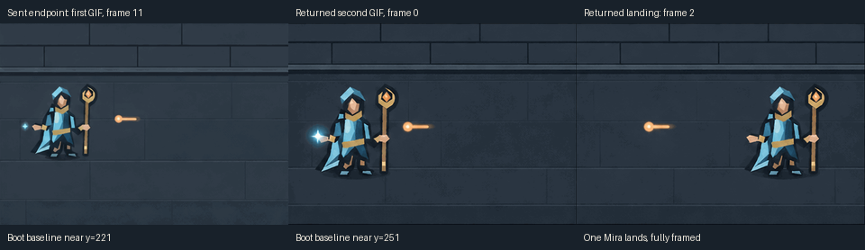

# Empty Target · second native GIF attempt

**Held: the teleport reads, but the join changes Mira's scale and position.**
No assembly or PR is produced. No reroll or further paid call is authorized.

Exactly one new second-clip request, grant `story-emberwake-gif-13`, conservative
planning reservation US$0.25, zero retries. No third clip or reroll is authorized.
The unknown SVG and successful first GIF are never retried or replaced.

[Call record](call.json) pins the exact sanitized multipart fields, input hash,
unique client trace and grant before dispatch. Prompt/settings remain once in
the [saved second draft](../story-emberwake-too-close-2026-11-06/second-gif-draft.json),
whose fields already use the actual `x≈196,y≈159` endpoint rather than `x=250`.
That file and the [actual sent PNG](../story-emberwake-too-close-2026-11-06/too-close-end-reference.png)
were checked byte-for-byte against `2f4f7a8788b9787c17f7d2e89e1d6ece10ed5549`.
Decoded PNG pixels also match the first GIF's composited frame 11 exactly.
The historical draft is not rewritten; this call record owns its dispatch.

Before dispatch, the [current guide](https://developers.openai.com/api/docs/guides/image-generation),
[edit schema](https://developers.openai.com/api/reference/resources/images/methods/edit)
and [Sunburst rates](https://developers.openai.com/api/docs/models/gpt-image-2.6-sunburst)
were rechecked November 6. Supported fields remain native GIF edits with one
`image[]`, Sunburst high quality/complexity, `n=1`, 480 × 336, 12 frames × 160 ms,
without streaming, partial images, compression or unsupported fidelity fields.
The US$0.25 bound allows 4,000 output image tokens (US$0.12), 10,000 input image
tokens (US$0.08) and 10,000 text tokens (US$0.05); the first real 12-frame call
cost US$0.072185 estimated. This is a conservative planning allowance, not an
endpoint-enforced charge cap. Use only the authorized existing network-secret
binding at `https://api.openai.com/v1/images/edits`; no credential is retained.

Exposure at grant: US$6.832340 successful estimates + US$28 unresolved holds +
this US$0.25 = US$35.082340 inclusive. All old holds, including the unknown SVG
US$3, remain untouched. Persist and report receipt or uncertainty before QA.

Inspect all frames and actual native/phone playback for one Mira vanishing from
the left and reappearing on the clear right landing, with the projectile passing
her vacated position only after she leaves. Check identity, staff, feet, support,
background, timing and duplicates. No new damage rule or accepted canon is
claimed. Preserve exact raw GIFs and all original provenance/looping metadata.
Only if the beat works, compose an explicit once-playing derivative and inspect
the join. Shared registry, defaults, runtime and selections stay unchanged.

## Receipt and exact preservation

HTTP 200, request `req_df0ad4e390bb49cca04695038c2ed5d2`, 43.08 seconds;
**US$0.072080 usage-derived estimate**, not an invoice. Receipt and native bytes
were saved and reported before QA. [Exact native second GIF](empty-target-original.gif)
retains the original looping behavior and all metadata. The old SVG uncertainty,
manual composition, first GIF and actual sent PNG are unchanged.

Both native GIFs contain a `C2PA_GIF` application extension: 21,806 payload bytes
in the first and 23,579 in the second. Both exact originals are retained, including
those extensions and `NETSCAPE2.0` looping metadata. Presence was inspected;
cryptographic validity was not independently verified. No re-encoded file is
presented as an API original, and no provenance is copied onto a fake assembly.

Second-call settlement would bring successful estimates to US$6.904420. The
unchanged US$28 unknown holds give **US$34.904420 inclusive**, subject to central
reconciliation. This consumes the one allowed call; unused planning allowance
does not authorize anything else. No active paid grant remains in this lane.

## Every-frame and actual playback findings

All 12 composited frames were inspected at 480 × 336 and 320 × 224; every frame
is 160 ms, totaling 1.92 seconds. Actual native playback was sampled at both
sizes in Google Chrome 157.0.8103.38, at eleven times from 0 to 2.4 seconds.
Individual frames, full-frame sheets and browser captures stay temporary.
Only the one compact comparison above is retained.

**What works:** one Mira stands left in frame 0, is absent in frame 1, and is
fully visible on the right from frame 2 onward. No duplicate Mira, detached
staff, cropped boot, ghost, portal or impact was observed. The projectile moves
left across her old position after she has gone. Its old position is empty when
the shot crosses it. The destination is clear, and both boots/staff remain fully
framed and appear supported. The 160 ms empty frame gives a readable blink.

**Why held:** at the very first frame, before the teleport, the model redraws
Mira about one quarter taller than in the sent endpoint. Her boot baseline
moves from approximately `y=221` to `y=251`, while her hood stays near `y=105`.
The cyan-accent vertical span grows from 117 to 146 pixels in a matched color
mask. The staff widens/repositions and the projectile jumps from approximately
`y=159` to `y=172`. These are visible changes at the clip boundary, not a hidden
claim of pixel identity. The right landing keeps the enlarged figure and lower
baseline. Masonry/floor seams are redrawn too. The early projectile step also
travels farther than the planned increment. The broad character remains
recognizable, but a fixed-camera, consistent-scale continuation is not achieved.

The second native GIF also has `loop=0`: actual playback resets to the left
opening after 1.92 seconds. No original loop metadata is changed. Because the
continuity gate fails, the conditional once-playing assembly and draft story PR
are not created. This is held evidence, not a completed two-clip story, accepted
canon or a new gameplay rule. No third clip or paid repair is proposed here.

## Portable history handoff

[Canonical history](../../library.json) preserves the historical base group of four attempts and three
unassigned source revisions: unknown SVG with **no image**, manual composition,
first native GIF, and held second native GIF. Actual sent PNGs remain linked
attempt documents with their hashes/derivation in the exact call records. The
old gallery's non-GIF revision preview assumes SVG, so PNG references are shown
through its supported image-document path rather than invented SVG revisions.
Those base records introduce no game assets, runtime files, selections or assembly.

At the frozen source handoff, canonical registration was pending. A private
candidate snapshot applied the original additive import and passed
the store's `verifyHistory`: 709 assets, 95 revisions, zero selections. The
unmodified offline gallery renderer was inspected there: three candidate source
revisions, exact prompt/settings text for both GIFs, the actual input PNG,
unknown-outcome document, original GIF preview bytes and reduced-motion blocking
passed. Layout checks passed at 320 × 740 and 390 × 844 with 20 px root text.
An initial custom probe tried a hidden child without opening the enclosing
attempts panel; the corrected navigation passed without changing shared code.
This is private snapshot QA, not canonical registration or a full game suite.

`format:maintenance`, static SVG safety, native GIF decoding/timing, exact input
and original-byte checks passed separately. Canonical `assets:history verify`
also passes for its unchanged 709 assets/92 revisions/zero selections; the three
candidate revisions were absent in that historical baseline. A pass
for existing records does not establish registration of this held work.
The known shared once-playing GIF
final-frame Stop/Play limitation is inherited and not fixed or exercised by an
assembly here; both raw clips loop. At that source handoff, registration and that inherited delivery limitation
were review blockers in addition to the visual hold. Current status is below.
No shared tooling, default, runtime, existing candidate, issue, deployment or PR
is changed. The exact frozen remote revision is supplied in the delivery handoff.

## Canonical source-study registration

The temporary additive import is retired after canonical record comparison.
[Combined held-study review](../held-story-studies-2026-11-06/README.md) owns the
current registration/technical status; earlier budgets, local snapshots and
source-owner publication statements above remain historical facts. Actual raw
GIFs, sent inputs, exact requests/receipts and holds remain unchanged.
The annotated layout guide is a distinct manual input derivative with its own
real first-GIF parent; the two continuation results are siblings. No assembly,
accepted story, unknown-SVG output or game selection is invented.
