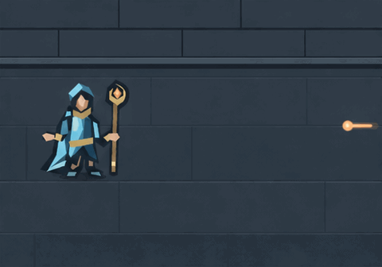

# Too Close · first native GIF attempt

**Returned: useful approach beat, with drift and a looping-container caveat.**
The exact original is preserved; no reroll or second call was made.

Grant `story-emberwake-gif-12` authorizes exactly one new reference-guided native
GIF, with a US$0.25 planning reservation and zero retries. This is the first
animation from the manually composed accepted-art reference. The earlier
unknown SVG call remains separate, reserved and never retried.

[Call record](call.json) identifies the exact sanitized multipart settings,
unique client trace, source commit and digests. The exact prompt/settings remain
once in the pinned [draft's `fields`](../story-emberwake-empty-target-composition-2026-11-06/first-gif-draft.json),
and the [sent reference PNG](../story-emberwake-empty-target-composition-2026-11-06/reference-manual.png)
is retained once. Both were verified byte-for-byte against
`8ad0f0e0c4abb5643659cb8ec57108c8f724bc83` before dispatch. The draft's historical
proposal status is not rewritten; this record owns whether its fields were sent.
Mira's unchanged geometry provenance and the composition review remain in the
[manual reference record](../story-emberwake-empty-target-composition-2026-11-06/README.md).

The [current guide](https://developers.openai.com/api/docs/guides/image-generation),
[edits schema](https://developers.openai.com/api/reference/resources/images/methods/edit)
and [model rates](https://developers.openai.com/api/docs/models/gpt-image-2.6-sunburst)
were rechecked November 6 before dispatch. They support reference-guided native
GIF edits with `image[]`, Sunburst, high complexity/quality, `n=1`, 12 frames,
160 ms per frame and 480 × 336. No streaming, compression, partial-image or
unsupported fidelity fields are sent. The conservative US$0.25 planning bound
uses 4,000 image output tokens (US$0.12), 10,000 image input tokens (US$0.08)
and 10,000 text input tokens (US$0.05); the earlier same-model 16-frame receipt
cost US$0.063195 estimated. These are conservative allowances, not an enforced
charge cap. Existing `OPENAI_API_TOKEN` reuse to the verified OpenAI endpoint is
authorized; no credential value is stored. Only one call is authorized.

Exposure at this grant: US$6.760155 successful estimates + US$28 unknown holds,
including the old SVG US$3, + this US$0.25 = **US$35.010155 inclusive**;
US$4.989845 uncommitted. Record receipt or uncertainty immediately, then inspect
all native frames and actual playback at 480 × 336 and 320 × 224. Keep the
native GIF exact; decoded frames are temporary. Evaluate one planted Mira,
full staff/feet, one approaching shot, landing clearance, background stability
and readable timing. Hold defects without a reroll. No game, registry, default,
selection, issue, PR or existing candidate changes are authorized here.

## Returned receipt and actual review

HTTP 200, request `req_afe88892a69e46a28c9bfa4e62242ce3`, 42.84 seconds.
The [exact native GIF](too-close-original.gif) is 327,560 bytes, SHA-256
`12fe7cf91b3a105c6ed201691c34b63d7ed9225fa867ff2cf0db534a896c0fe8`.
The receipt was persisted and reported before extended QA. Usage was 630 image
input, 673 text input and 2,126 image output tokens: **US$0.072185 estimated**,
not an invoice. The actual response/usage remains once in `call.json`.
The consumed grant does not authorize any remaining or future call. Replacing
this reservation with its estimate yields US$6.832340 successful estimates +
the untouched US$28 unknown holds = US$34.832340 inclusive, subject to central
coordinator reconciliation. The earlier unknown SVG's US$3 is not released.

All 12 composited native frames were decoded temporarily and visually inspected
at 480 × 336 and 320 × 224. Each is 160 ms: **1.92 seconds total**, with no timing
extension or discarded frame. Actual original-GIF playback was also sampled in
Google Chrome 157.0.8103.38 at both rendered sizes, at eleven times from 0 to
2.4 seconds. The same native bytes supplied both browser views. Temporary frame
sheets and browser captures remain only in ignored review output.

- **Beat reads:** exactly one Mira remains at left with a full staff and both
  feet visibly supported. One warm head with a rightward tail moves left. No
  duplicate heroine, caster, portal, impact or premature teleport appears.
- **Ordering reads:** the projectile clears the entire proposed future figure
  footprint `x≈302..415` by frame 7 (1.12 s). Its final warm head is near
  `x≈196,y≈159`, and its visible trail ends near `x≈227`; the left figure remains
  separated. The last three frames approximately hold that ending, with a tiny
  cold cue by her free hand in the last two. At phone size the approach remains
  legible; the 1.92-second beat does not need padding to communicate the threat.
- **Prompt deviations:** the shot travels farther than the requested `x=250`
  ending, and slightly above `y=164`. The reference is redrawn: masonry gains
  texture and shifted seams, and Mira shifts/facets differently from the exact
  accepted geometry. Within the GIF the face, cloth/staff edges and background
  vary slightly. Broad identity and framing survive, but neither unchanged
  geometry nor a fixed background is established.
- **Native playback caveat:** the GIF has `loop=0` (infinite repeat). Browser
  playback visibly jumps the projectile back to the right at about 1.92 s.
  The internal frames do not animate a return, but the container does repeat.
  The original is not modified to conceal this. It remains a source candidate,
  not an approved standalone story delivery or a completed two-clip series.

## Possible second clip, not dispatched

[Actual endpoint reference](too-close-end-reference.png) is exactly composited
zero-based frame 11 (1.76–1.92 s), decoded to RGBA and PNG-encoded without pixel
edits. It is retained solely as the proposed next input, not as a frame catalogue.
Its SHA-256 is `9c41ea5a15ed9814a0395604c68298c0eeb41e3d76d5ebb90f558c30f45f0fa4`.
It has **not** been sent to an image-generation service.

[The exact second-step draft](second-gif-draft.json) begins from this real
endpoint, including its revised shot position and background. The shot continues
left; Mira vacates the left position between frames 1–2 and is fully planted at
the already clear right landing by frame 3. The projectile then crosses her
vacated position. Never show two Miras, a walking transfer or an invulnerability
effect. The target boot baseline follows the actual endpoint near `y=221`.
This is a continuity proposal, not a domain simulation or accepted history.

The proposed second call uses the same verified native GIF edit parameters:
one actual PNG input, 480 × 336, 12 × 160 ms frames, Sunburst high quality and
complexity, `n=1`, zero retries. **US$0.25 conservative per-call planning bound**
again allows 4,000 output image, 10,000 input image and 10,000 text tokens at
the current rates. This is over three times this call's observed estimate, but
remains a planning allowance rather than an enforced endpoint charge cap.
No next grant, client trace or dispatch exists. A separate finite grant and
review decision are required; no attempt is registered for an unsent draft.

Technical decoding and source/byte checks do not imply visual acceptance. Shared
history registration remains with the serial coordinator; the old unknown SVG,
manual reference and this new GIF are separate records. No registry, game,
selection, issue or PR was changed. No original or failed-attempt byte was edited.
