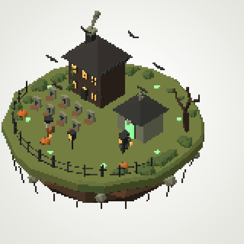

# Haunted Island

A standalone 15-second haunted-island movie trial, retained from
[PR #53](https://github.com/qianyizhang/game/pull/53).

[Download the GIF](haunted-island.gif): 480 × 480, 225 frames, 15 fps, exactly
15 seconds. The GIF is the retained delivery; the original PR contains no
editable scene source.

## Outcome

The trial uses a simplified pixel-art treatment. The requested depth-based
outline pass and some finer effects remain unimplemented. Its technical media
delivery and its fidelity to the original visual brief are separate results.

Compare with [Little Haunt](../little-haunt/README.md) and
[Lantern Keep](../lantern-keep/README.md) in the [movie experiment collection](../README.md).
The retained GIF bytes match the original PR head
`a9db5e15693c2a9ffd64728d38072a5777b6f214`.
