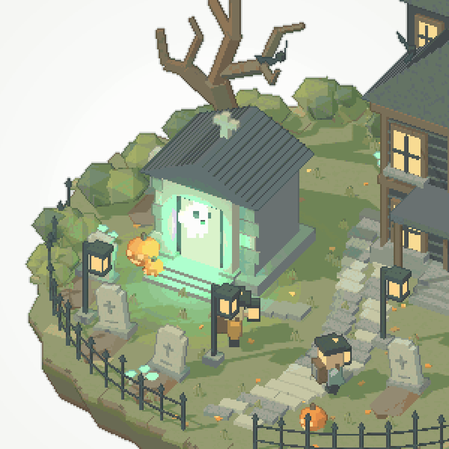

# Lantern Keep

A standalone, 15-second pixel-art ghost hunt on a floating graveyard island.
Three chibi hunters capture eleven ghosts, confront a giant ghost, and finish
with a calm wide orbit. The scene has no UI.

- [Download the animated GIF](lantern-keep.gif): 900 × 900, 20 fps, 300 frames,
  exactly 15 seconds, repeating playback.
- [Open the single-file scene](lantern-keep.html): download and open in a WebGL2
  browser. Three.js 0.170.0 and all procedural assets are embedded; no server,
  installation, or network connection is needed.



## Rendering and timing

The orthographic camera stays at isometric elevation while orbiting and zooming.
Rendering uses one-third of the displayed square's resolution, nearest-neighbour
scaling, camera translation snapped to the art-pixel grid, a depth-based outline
pass, restrained surface texture, and palette quantisation. Only chimney smoke
uses a screen-door pattern. The GIF uses a fixed 256-colour palette without
dithering, then lossless GIF optimisation.

| Time    | Action                                                              |
| ------- | ------------------------------------------------------------------- |
| 0–1 s   | Crypt flash and eleven-ghost burst                                  |
| 1–5 s   | Hunters run, lock beams, and capture ghosts along spirals of sparks |
| 5–9 s   | Boss rises, camera shakes, bats scatter                             |
| 9–12 s  | Three crossed beams shake and illuminate the boss                   |
| 12–13 s | Boss bursts into shards; manor windows light up                     |
| 13–15 s | Calm wide orbit                                                     |

The final wide view cuts back to the opening close-up when playback repeats;
this is a repeating sequence, not a seamless camera loop.

## Capture and verification

The HTML is the retained, self-contained delivery, with its bundled library's
MIT license included. It is independent of the application and gallery catalogue.
The embedded bundle is kept intact for offline playback; its surrounding HTML
and this record are checked by Prettier and the repository inventory gate.

For deterministic capture, append `?capture` and call `window.renderAt(seconds)`
after `window.__ready` becomes true. At a 900 × 900 viewport, the canvas is
300 × 300 art pixels. The delivered GIF samples `i / 20` for `i = 0…299` and
upscales each frame with nearest-neighbour filtering.

The scoped browser test checks the delivered file without Vite transformation:
offline loading, automatic animation, deterministic seeking, absence of visible
controls, and exact 3× scaling at desktop and phone sizes. GIF validation checks
all frame delays and dimensions and uniform 3×3 blocks on sampled decoded frames.
Selected opening, capture, boss, burst, and final views received visual self-review;
this does not establish independent art acceptance.

```sh
npm run test:browser -- --project=functional tests/browser/lantern-keep.spec.ts
```
