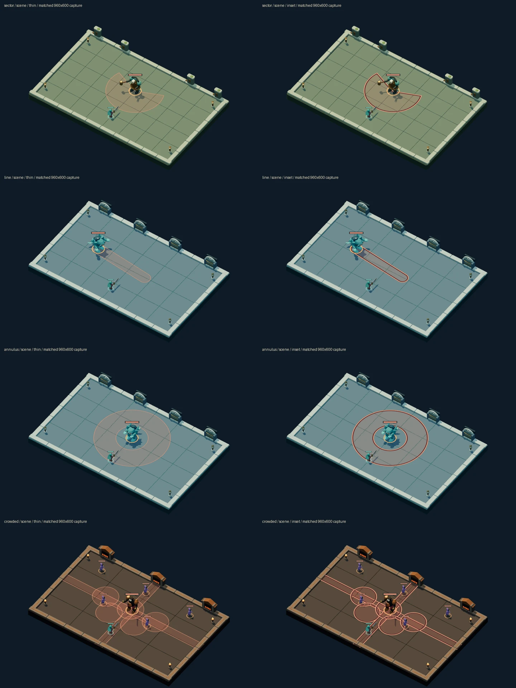
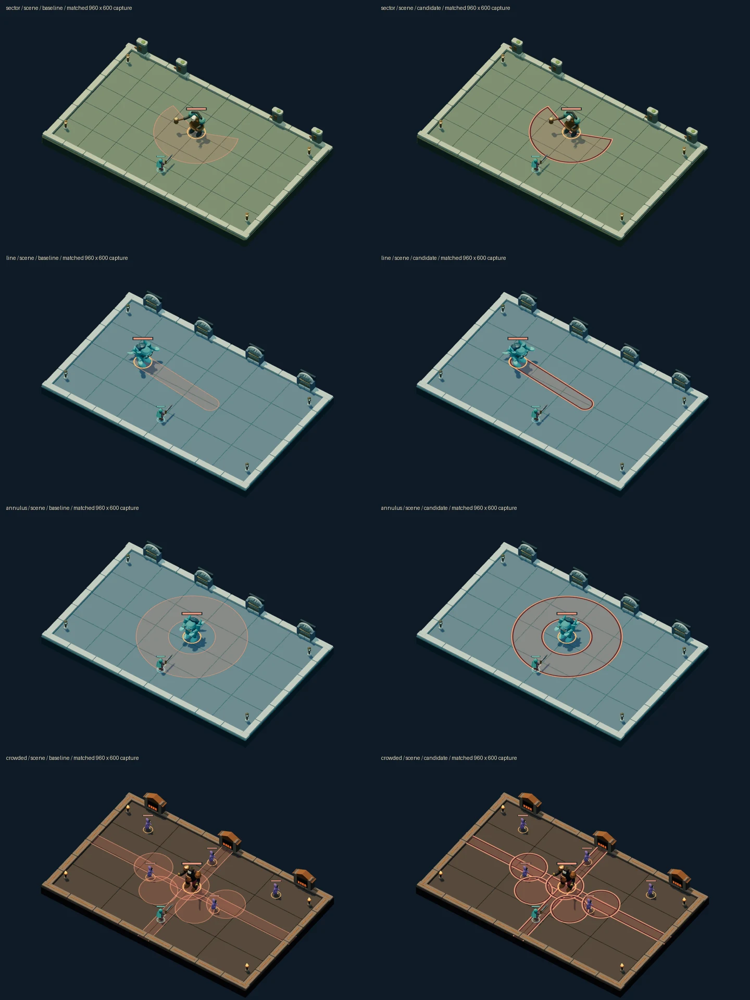
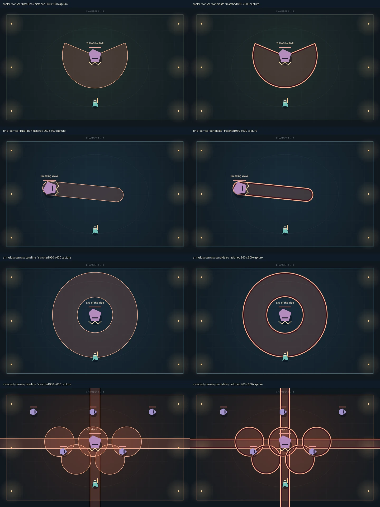

# Night Passage inward threat rim: validation, 2026-10-27

## Inset refinement: awaiting independent final review

The current candidate preserves the recovered rim's 9px dark / 4px coral inward
bands while avoiding clip masks on supported footprints. It uses inset stroke
centerlines; wide-sector corners use parallel radial edges and bevel joins.
Narrow or degenerate sectors, small circles/capsules and thin annuli retain the
clipped construction. Rules geometry and the translucent fill remain unchanged.
Current renderer source SHA-256: `d47c955dcb040525657dbc84a2eca3f38de324e068c664dad8156d5118b5a1a1`.

Self-review of matched desktop views and identical enlarged crops finds equivalent
boundary readability: the annulus hole stays open, line ends remain rounded, and
sector edges and crowded circles remain distinct. Beveled sector corner pixels
are slightly different from the clipped construction. This is not independent
visual approval. Captures wait for asset loading before the final redraw; a timed
capture that still showed fallback models was replaced before publication.

[Canvas comparison](../assets/night-passage-threat-rim/inset-canvas.webp),
[clipped/inset scene zoom](../assets/night-passage-threat-rim/inset-scene-zoom.webp),
and [clipped/inset canvas zoom](../assets/night-passage-threat-rim/inset-canvas-zoom.webp)
cover the same four scenes. The zoom pairs compare the recovered rim with this
refinement; the full-scene pairs compare the thin outline with this refinement.

A new browser regression checks **114 cases** at 1× and 2× backing resolutions:
all four shapes, rotations, small radii, narrow/wide sectors and thin annuli.
All painted pixel centers must lie within a **continuous one-backing-pixel rules
expansion** for antialiasing. All 114 pass locally in Chromium, with clear annulus
centers and restored context paint/join/clip state. The old thin outline fails all
114 cases as a negative control. This continuous test resolves a limitation of
the old grid-neighbor probe: that probe flagged the same 12 narrow-apex pixels in
both recovered and experimental rendering because it could miss a thin footprint
between sample points. The old results are retained; no existing check was weakened.

The 240-command legal replay again has byte-identical exports for clipped/inset,
normal/reduced motion and both consumers: hash
`e86cf14c443eef03c7291a73d92ec41def2b9a446e5939ed658a6c54cb3da1c0`.
Matched frozen renders preserve state under both motion settings.

The sequential isolated comparison uses the same Linux/Chromium environment and
six-threat 1920×1200 clear/draw/readback workload described below. Order is
ABC–CBA repeated three times, with 20 warmup and 100 measured frames per batch.
[Raw batches and source hashes](../assets/night-passage-threat-rim/refinement-cost.json)
record the exact inputs.

| Variant | Median per frame |     Batch range |
| ------- | ---------------: | --------------: |
| thin    |        3.7105 ms |  2.830–6.671 ms |
| clipped |       11.7765 ms | 9.361–17.013 ms |
| inset   |        4.5500 ms |  4.217–4.847 ms |

Inset drawing is about 61% cheaper than the clipped candidate in this run, with
about 0.84 ms remaining overhead versus thin outlines. Batch drift and software
rendering limit extrapolation. These are draw/readback measurements, **not GPU
FPS**, end-to-end frame timings or a hardware performance guarantee.

Targeted ESLint and TypeScript checks pass. All 71 scoped application tests across
9 scene/chronicle files pass (38.10 seconds). Exact-head CI results belong to
PR #31; no passing CI result is implied before that run finishes.
The earlier full-suite timeouts below remain historical failures, not waived
checks or an all-green baseline. Stable Chrome was not installed locally; the
canonical browser gate remains required through CI. Final visual acceptance and
merge belong to independent review.

## Recovered clipped candidate: historical validation

The recovered rim improves desktop threat recognition in self-review, but is **not
accepted**. Its measured draw/readback cost is materially higher, the local full
gate fails time limits, stable Chrome is unavailable, and independent visual review
remains outstanding. [Issue 26](https://github.com/qianyizhang/game/issues/26) and
[draft PR 31](https://github.com/qianyizhang/game/pull/31) remain open.

## Source and intended change

The exact preserved candidate was recovered onto main `31140ad`, retaining merged
CI #22 and hero/crypt #24. Source commit `c523c2f` changes only
`src/games/night-passage/ui/presentation/threats.ts`; its SHA-256 is
`7c48547cdc21414fec92ca23cd707c92b5d1b488049256e1b19e89a434ac97f6`.
Main subsequently advanced to `0483708` with workflow documentation only.

The existing translucent fill and rules path remain. Dark 18px and coral 8px
strokes are clipped inward, leaving 9px and 4px bands inside the footprint. Both
the canvas view and the 3D ground decal consume this renderer. Rules, hit
detection, floor textures and save formats are unchanged.

## Matched visual evidence

The brief is attack-footprint recognition at a 960 × 600 desktop arena: capsule,
sector, circle and annulus, including the annulus's safe center. The material is
the existing translucent coral over the existing floors, with a dark separator
and coral boundary; the intended change is boundary clarity without texture.

Each row uses the same synthetic presentation state, camera, tick and display
size: sector, line, annulus, then crowded cross/circle overlaps. These fixtures
use the production room/actor renderers; they are not legal campaign witnesses.
Left is thin-outline baseline; right is the recovered candidate. Sheet cells are
720px-wide reductions of the original 960 × 600 captures.

[3D enlarged pixel crops](../assets/night-passage-threat-rim/scene-zoom.webp) and
[canvas enlarged pixel crops](../assets/night-passage-threat-rim/canvas-zoom.webp)
use identical crops at 2× pixel enlargement, not a changed camera.

Self-review: the charge and sector boundaries separate more clearly from the
lighter 3D floors. Both annulus boundaries are easier to follow and its center
stays open. Crowded circles remain individually readable, with increased visual
weight at overlaps. This assessment is not independent visual approval.

## Geometry, state and motion

The four representative rules-footprint probes find zero painted pixel centers
outside a one-pixel antialiasing neighborhood. Antialiased fringe pixels are
reported separately; this does not claim zero fractional coverage beyond a
mathematical curve. The probe uses unexpanded rules geometry (`radius = 0`),
not the player's collision-radius expansion.

All 32 frozen render combinations preserve their state: four scenes, two views,
two motion preferences, baseline and candidate. A separate legal replay of 240
accepted commands with seed `issue26-legal-replay`, sword/vigor/fleet, clears
three rooms and produces identical exported bytes across baseline/candidate and
normal/reduced motion. Restore/re-export is byte-identical, and both renderers
leave the save unchanged. Export SHA-256:
`e86cf14c443eef03c7291a73d92ec41def2b9a446e5939ed658a6c54cb3da1c0`.
This is bounded replay evidence, not a complete browser interaction campaign.

## Measured cost

Environment: Linux, cgroup capacity 4 CPU / 16 GiB, Node 24.21.0, npm 11.19.0,
headless Chromium 154.0.8037.57. Capacity is not measured resource use. The
comparison renderer uses software WebGL; this browser is separate from the
repository's required stable Chrome.

The isolated probe uses a 1920 × 1200 backing canvas (2× arena resolution), six
threat paths per frame, clearing and a forced one-pixel readback. ABBA order is
repeated three times; every batch has 20 warmup and 100 measured frames. There
is no competing gate. [All batch values](../assets/night-passage-threat-rim/cost-isolated.json)
remain available.

| Variant               | Median draw/readback cost per six-threat frame |
| --------------------- | ---------------------------------------------: |
| Thin-outline baseline |                                      2.8355 ms |
| Recovered clipped rim |                                      8.2755 ms |

The additional 5.44 ms and approximately 2.92× cost prevent a performance-neutral
claim. These are draw/readback timings, not FPS, complete scene frame time or
hardware-device performance guarantees. An unpromoted inset-path experiment
reduces this cost in a direct comparison but changes sector corner construction;
it needs additional geometry and visual review before replacing the candidate.

## Verification and remaining work

For `c523c2f`, maintenance/static checks, Python/tool/DCC contracts and build pass.
The full application run finishes **566 passed / 8 timeouts across 95 files** in
796.17 seconds. No limits or assertions were changed. Timeouts occur in:

- Emberwake native6 replay reconstruction and policy progression witnesses.
- Hearth arena, recruitment experiment and recruitment harness.
- Two shared policy-rollout cases.
- Night Passage spectator playback.

A clean-main `31140ad` focused comparison reproduces the Night Passage playback
failure (7.05 seconds against its unchanged 5-second budget). Hearth arena passes
that rerun. The other seven failures are not all established baseline failures;
the full gate remains failed. All **37 simulations across 8 files pass** separately
in 89.02 seconds because the failed application stage prevents the chained gate
from reaching them.

The standard Night Passage scene browser suite stops at its unmodified startup
guard: `/opt/google/chrome/chrome` is absent. No suite tests execute. Chromium
presentation probes are supplementary and do not replace that requirement.

Do not mark ready or merge from these results. Next work is performance refinement
or a reasoned decision to discard, independent visual review, and required browser
coverage. Raw captures, probes and logs remain in the active local review bundle
`.artifacts/issue26/`; the selected evidence above is the durable decision record.
