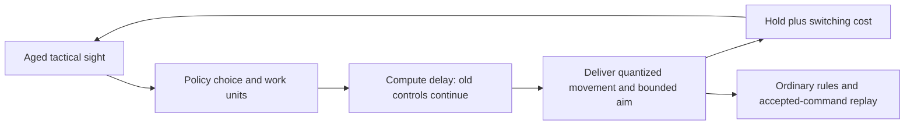

# Night Passage control and difficulty calibration · 2026-10-14

The frozen deliberate policy escaped on **49/50 Standard (98%), 38/50 Veteran (76%)
and 16/50 Ordeal (32%)** evaluation episodes, meeting all three agreed targets.
All **15 weapon/tier winning paths** were replay-verified under Standard controls;
Spear/Ordeal required a separate development search. Rules-4 gameplay and scores
remain compatible. These are seeded engine outcomes, not human win rates.

Delayed perception, declared tactical work, control costs, gameplay difficulty and
finishing-time scoring are implemented. The [compact receipt](2026-10-14-night-passage-control.json)
pins the final executable and retains calibration history, results and witness hashes.
The experiment started October 14 and completed October 15 locally.

## Mechanism and fairness

The browser-independent seeded rules remain authoritative. A policy chooses commands;
the controller advances the ordinary game while delaying and bounding their delivery.
The original exact-state baseline obeys combat rules and has no future draws or RNG
access through its observation. Its precise structured perception and immediate aim
are advantages over human play, so its historical 30/30 wins were insufficient evidence
that the game was balanced for people.



| Exposed to constrained policy                                  | Withheld or reduced                                  |
| -------------------------------------------------------------- | ---------------------------------------------------- |
| Phase, elapsed tick, score, position, HP, equipment, resources | Seed, RNG, future draws, journal                     |
| Enemy position, HP, radius and aim                             | Windup, stagger and damage-status clocks             |
| Visible threat shapes and early/late warning                   | Exact remaining windup                               |
| Hazard position, radius, warning/active flags                  | Offset, cycle, activation countdown                  |
| Projectile position and sensor-derived velocity                | Direct velocity field, lifetime                      |
| Dash-ready, protected and striking flags                       | Player cooldown, immunity, strike/buffer/cast clocks |
| Current offered rewards, routes and legal menu choices         | Unoffered future choices                             |

Snapshots age by the configured number of ticks. Projectile velocity is derived
from consecutive aged simulation snapshots, including frames between delivered
decisions; straight flight can therefore reveal effectively exact velocity. This is
a continuous structured sensor, not screenshot perception. Menus are current;
chamber transitions reset history and held input, with bootstrap explicitly marked.
Rejected actions return the same redacted view. Evaluator-only results/export are
never passed to the built-in policy.

**Compute proxy:** `workUnits = marked entity scans + escape candidates + geometry helpers`.
Distance, containment and cover helpers count; general arithmetic, allocations,
menu ranking and some additional scans do not. The count is deterministic and
inspectable, not CPU time or a comprehensive instruction count.

**Delivery delay:** `reactionTicks + ceil(workUnits / workPerTick)`.
**Next decision hold:** `max(holdTicks, requestedTicks) + switchTicks × min(changes, 3)`.
Changes count movement direction, offensive priority slot and newly requested dash.
Old controls continue during delay; movement has eight headings and aim slews each
executed tick. Death, room exit or budget exhaustion cancels pending delivery.
Actual executed inputs, not intended actions, enter the replay.

At Standard settings, 96 work units add three ticks of delay (one reaction plus
two work ticks). Two control changes add four hold ticks for a one-tick request,
so the next decision is seven ticks later: 116.7 ms at 60 ticks/s. Work and motor
costs are separate; extra reasoning may improve the action while increasing delay.

| Control preset | Snapshot age | Reaction | Work units/tick | Minimum hold | Ticks/change | Aim/tick |
| -------------- | -----------: | -------: | --------------: | -----------: | -----------: | -------: |
| Light          |            0 |        0 |             256 |            1 |            1 |      45° |
| Standard       |            1 |        1 |              64 |            2 |            1 |      30° |
| Heavy          |            3 |        2 |              32 |            4 |            2 |      18° |

One tick is 16.67 ms. These are engine-calibrated handicaps, not measured human
latencies. Initial exploratory settings (6 observation/3 reaction/32 work/6 hold/2
switch ticks and 6° aim/tick) defeated pilot sword/bow policies; those exploratory
pilots were not retained as a fully pinned experiment. The final settings were then
tested on the declared development grid below. Heavy is an optional stress setting,
not the balance reference.

Quick evaluates four escape landings, balanced eight, deliberate eight landings plus
intermediate path checks. All share the same control rules, survival reward ranking,
ability-request windows and weapon distance settings. Candidate evaluation occurs
when a late visible threat covers the player; extra work is not charged merely for
the policy's name. No ranking is forced. Ability buffering and damage-triggered call
charge can make outcomes nonmonotonic as timings or damage change.

The JSONL interface is cooperative. Evaluator-owned `act` and `evaluate` apply
measured built-in work; manual `step` accepts self-reported work, and free `suggest`
followed by underreported `step` can avoid that cost. Controller replay metadata
records origin, not certification of subsequent manual play. Trusted callers can
reconstruct a chosen seed; this is not a hostile-code security boundary.

## Gameplay and score

| Tier     | Enemy speed | Enemy damage | Recovery duration | Room/market healing | Hunter flank offset |
| -------- | ----------: | -----------: | ----------------: | ------------------: | ------------------: |
| Standard |          1× |           1× |                1× |                  1× |                   0 |
| Veteran  |       1.25× |        1.30× |             0.90× |               0.80× |           ±35 units |
| Ordeal   |       1.45× |        1.65× |             0.80× |               0.65× |           ±55 units |

Higher-tier hunters use visible charge lanes with their original 38-tick windup;
flanking alternates by hunter identity. Damage and pursuit pressure change, while
player controls are identical across tiers. Healing is rounded; maximum-HP gains
and Mercy's three-health room-clear effect retain their original values. Standard
combat preserves the original rules-4 behavior.

New chronicles record rules-5/content-4 and score-2:

`100 × combatClears + escape × (10,000 + floor(2000 × 36000 / (36000 + executedTicks)))`.

At 5/10/20 combat minutes the bonus is 1,333/1,000/666. Delays count; menus,
pauses, playback speed, wall-clock computation and unused requested ticks do not.
Deaths/timeouts get chamber points without a bonus. All escapes outrank failures;
room points and time can trade off within victories. Benchmarks rank wins, then
mean score including failures, then median winning ticks. Do not compare old and
new scores as identical metrics.

## Protocol and calibration

Each condition uses ten shared seeds × five weapons, a fresh profile and Root/Feather
runes. Budgets are 20,000 accepted policy/menu decisions (including start) and
120,000 executed combat ticks. Internal one-tick delivery frames are not additional
policy decisions. Every death, timeout and error stays in the denominator; errors
invalidate a measurement. Seeds are paired across conditions, not 50 independent
human trials.

Development pool: `passage-control-development-1-00` through `-09`. A three-seed
screen preceded the ten-seed grid. The broad grid used Veteran damage 1.25 and
Ordeal damage 1.30; their deliberate rates (84% and 60%) exceeded the agreed targets.
Separate development reruns changed only Veteran damage to 1.30, then Ordeal damage
to 1.50. After the first fresh Ordeal grid exceeded its target, its pool was retired
and damage increased to 1.65; the final development rerun selected deliberate (13/50).
The reference remains deliberate on every tier.

| Final development condition | Quick | Balanced | Deliberate selected |  Target |
| --------------------------- | ----: | -------: | ------------------: | ------: |
| Standard                    | 47/50 |    47/50 |               50/50 | 80–100% |
| Veteran, damage 1.30        | 26/50 |    33/50 |               40/50 |  40–80% |
| Ordeal, damage 1.65         |  5/50 |     8/50 |               13/50 |  10–40% |

Every weapon had a standard-control win on each tier in the initial development
grids. The final Ordeal ten-seed grid lacked a spear win; a separately declared
additional development search supplied that feasibility witness. The broad
900-episode development grid had 589 wins, 310 losses, one timeout and zero errors;
the later Veteran/Ordeal reruns each had zero errors/timeouts. One early report
recorded `decisionTicks: 6` although constrained requests actually used 1; subsequent
reports corrected that bookkeeping. Historical source/bundle identities remain
separate. The original legacy baseline receipt is unchanged.

The freeze manifest was written before evaluation and captures chosen policy,
parameters, budgets, seed identities and source/tool/bundle hashes. Engine/tool
sources were frozen during compilation and evaluation. Source files are hashed after
compilation; retained compiled bytes are the authoritative executable. Some older
calibration bundles were retained, but the Ordeal03 compiled bundle was not retained.
Those historical outcomes have source/digest receipts, not a full executable archive.
Provisional rules-5 tuning replays require their matching compiled snapshot;
the rules-5 version label alone does not identify all development parameters.

## Fresh evaluation

Standard/Veteran use original reserved pool 1, with complete 600-episode outcome
parity confirmed against the final executable. Revised Ordeal uses newly reserved
pool 2. The first Ordeal pool's 22/50 (44%) result is retained as a failed-target
measurement and was retired before damage-only retuning; it is not fresh evidence
for the final parameters. Policies and controls were frozen before the relevant
fresh pool. Source/tool hashes match the final freeze and retained compiled bundle
`d87013f8a87e0512df2b827e3de41d23034ed5e0b212c7232ce9eae4fda0f2e4`.

### Reasoning spectrum under Standard controls

Each cell is ten seeds × five weapons. Deliberate was selected on development; it
also had the highest observed evaluation wins. All targets apply to this control
preset and tested policy set. The final grid contains **900 episodes, zero errors
and one timeout**, in the Light/Ordeal condition. All nine Standard-control
policy conditions had zero errors/timeouts.

| Tier     | Quick | Balanced | Deliberate selected | Target |
| -------- | ----: | -------: | ------------------: | ------ |
| Standard | 46/50 |    46/50 |               49/50 | Met    |
| Veteran  | 25/50 |    26/50 |               38/50 | Met    |
| Ordeal   |  2/50 |     5/50 |               16/50 | Met    |

### Control spectrum with balanced held fixed

Exact is a separate original-baseline diagnostic; it changes both policy and
perception, so it cannot establish the causal effect of control restrictions.

| Tier     | Light | Standard | Heavy | Baseline / exact diagnostic |
| -------- | ----: | -------: | ----: | --------------------------: |
| Standard | 50/50 |    46/50 | 11/50 |                       49/50 |
| Veteran  | 49/50 |    26/50 |  1/50 |                       42/50 |
| Ordeal   | 32/50 |     5/50 |  0/50 |                       14/50 |

**Counterexample:** Heavy/Ordeal produced **0/50** escapes. Heavy is a stress preset;
it is unsuitable as the default difficulty reference. Light/Ordeal's 32/50 versus
Standard/Ordeal's 5/50 uses the same balanced policy and shows why the two spectra
must stay separate. Exact did not dominate deliberate on every tier.

### Measured work and action rate

Combat-decision frequency is `60 × totalCombatDecisions / totalExecutedTicks`,
weighted by simulated exposure across wins and failures. A decision may hold
several input ticks. These are simulation rates, not benchmark CPU throughput.
The exact baseline normally requests six-tick frames (nominally 10 Hz); its work
and delay are unmetered, not zero computation.

| Tier / policy         | Work units/decision | Executed compute delay/decision | Combat decisions/s |
| --------------------- | ------------------: | ------------------------------: | -----------------: |
| Standard / quick      |               22.70 |                            2.00 |           13.31 Hz |
| Standard / balanced   |               24.10 |                            2.05 |           13.15 Hz |
| Standard / deliberate |               26.23 |                            2.08 |           13.07 Hz |
| Veteran / quick       |               23.12 |                            2.00 |           13.27 Hz |
| Veteran / balanced    |               24.94 |                            2.06 |           13.08 Hz |
| Veteran / deliberate  |               27.25 |                            2.09 |           12.99 Hz |
| Ordeal / quick        |               23.12 |                            2.00 |           13.29 Hz |
| Ordeal / balanced     |               24.68 |                            2.06 |           13.10 Hz |
| Ordeal / deliberate   |               27.36 |                            2.09 |           13.00 Hz |

Standard delay is about 33–35 ms; the total cycle including motor hold is about
75–77 ms. Mean work differs despite a shared timing model. The count excludes
menu decisions; their safe screens do not advance combat.

### Weapon outcomes and feasibility

Selected deliberate policy, ten evaluation seeds per weapon:

| Weapon | Standard | Veteran | Ordeal |
| ------ | -------: | ------: | -----: |
| Sword  |    10/10 |    8/10 |   5/10 |
| Spear  |     9/10 |    5/10 |   0/10 |
| Shield |    10/10 |    7/10 |   1/10 |
| Bow    |    10/10 |   10/10 |   8/10 |
| Fists  |    10/10 |    8/10 |   2/10 |

**Unresolved balance:** Spear had **0/10** Ordeal wins under all three policies in
the final evaluation grid; bow had 8/10 under deliberate. Aggregate target success
does not imply equal weapon difficulty. A further development search found a legal
Standard-control deliberate spear escape at seed
`passage-control-development-1-48`, after 39 attempts: **13,656 points, 26,257 ticks**.
The search stopped at its first win and is feasibility evidence, not a rate estimate.

All 15 witness files have verified byte hashes, final-engine import parity, terminal
victory/score/tick parity, spectator end-state parity and backward-seek parity.
Fourteen come from evaluation; Spear/Ordeal comes from the separate development
search. No Light/exact witness satisfies this requirement.

### Finishing-time results

Selected deliberate; median time includes winners only, while mean score includes
all 50 attempts. Comparisons are within each tier.

| Tier     | Median winning combat time | Mean score, all attempts |
| -------- | -------------------------: | -----------------------: |
| Standard |                    489.2 s |                 13661.60 |
| Veteran  |                    464.2 s |                 11099.54 |
| Ordeal   |                    445.9 s |                  5889.76 |

## Reproduction and evidence

Use the pinned Node runtime:

```sh
source ~/.nvm/nvm.sh
nvm use
npm run --silent engine:night-passage -- evaluate --split evaluation --pool 1 --seeds 10 --difficulty standard --controls yes --witnesses yes --out test-results/night-passage-reproduction/standard.json
npm run --silent engine:night-passage -- evaluate --split evaluation --pool 1 --seeds 10 --difficulty veteran --controls yes --witnesses yes --out test-results/night-passage-reproduction/veteran.json
npm run --silent engine:night-passage -- evaluate --split evaluation --pool 2 --seeds 10 --difficulty ordeal --controls yes --witnesses yes --out test-results/night-passage-reproduction/ordeal.json
npm run --silent engine:night-passage -- play --seed passage-control-development-1-48 --weapon spear --difficulty ordeal --control standard --policy deliberate --out test-results/night-passage-reproduction/spear.json --replay test-results/night-passage-reproduction/spear.replay.json
```

`--difficulty` can split the same grid by tier. `evaluate` retains the compiled bundle,
raw episode reports and the first observed standard-control winning replay per
weapon/tier when present. Missing combinations are reported rather than supplied
from Light or exact play. Use a fresh output directory to preserve earlier receipts;
explicit output paths overwrite existing files.
After evaluation-driven tuning, retire the pool and increment `--pool`; do not call
reused seeds fresh. Raw evidence remains local under ignored
`test-results/night-passage-control/`; compact published receipts record hashes,
conditions and witness identities without a large fixture archive.

## Compatibility and verification

Rules-4/content-3 chronicles retain original Standard gameplay, score-1 and replay
meaning. Import, continued play, export, playback and backward seeking select the
recorded rules. The pre-change bow witness retained **12,700 points and 28,995 ticks**, with
continued-play/import/playback parity against the delivered engine; canonical replay bytes preserve the original payload (the CLI artifact's
trailing file newline is excluded from canonical-export equality).

**Maintained scope passed:** formatting, lint, TypeScript, Python, tools, DCC
contracts, inventory and production builds through `npm run check`. The tooling
suite had 85 passes and one sandbox-blocked loopback skip; its approved loopback
suite subsequently passed 9/9 without skips. The affected loopback sources were
unchanged by the final Ordeal edit.

**Application/simulation scope passed:** **418 tests in 67 files**, plus **37 seeded
simulations in eight files**. **Browser scope passed:** **14 disposable-profile
journeys**, approved execution, 47.6 seconds, covering difficulty/reload, legacy
continuation/scoring, constrained replay score/metadata and spectator seeking.
New controller regressions cover delivery order, redaction, invalid input, bounded
aim, cutoff and replay parity; score and legacy continuation have explicit tests.

Three parallel read-only audits checked control fairness,
compatibility/scoring and experimental methodology; their supported findings were
corrected or documented above. Assets and rendering code are unchanged; geometry,
Blender authoring and aesthetic acceptance are outside this slice.

## Limits and follow-up

- Ten seeds per tier are a calibration/evaluation sample. Per-weapon outcomes matter;
  an aggregate target alone does not establish equal weapon balance.
- Stronger reasoning can lose time. Quick and balanced may switch order; exact baseline
  can underperform a constrained policy. Report observations without forcing a story.
- Structured geometry, exact positions and continuous projectile estimates remain
  substantial advantages. Human playtesting is needed before a human fairness claim.
- Default Standard is deliberately accessible. Veteran/Ordeal supply the challenge
  spectrum; Heavy controls may be unsuitable for ordinary play.
